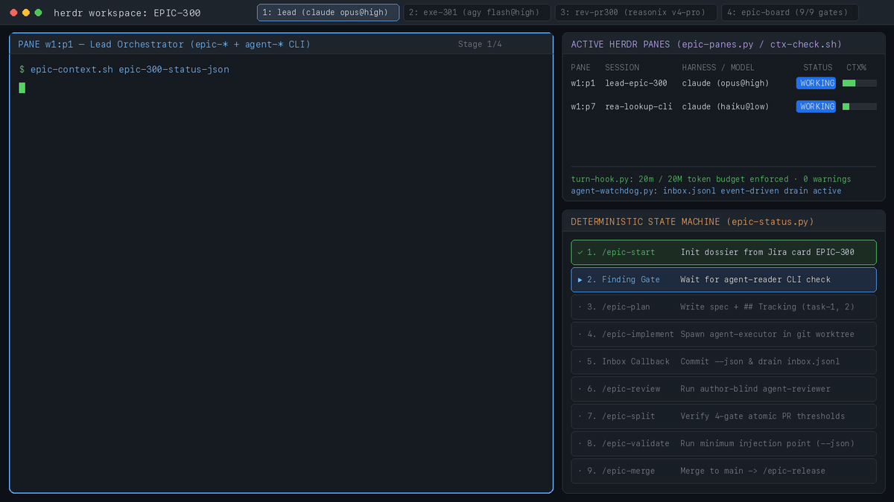

# Epic Engine

> **A Multi-Agent SDLC Operating System: Harness-Agnostic, Disk-Backed, and Deterministic.**

Epic Engine coordinates autonomous AI coding agents across the entire software development lifecycle. It eliminates agent amnesia, PR restacking churn, and unverified deployments through three clean namespaces:

1. **`skills/epic/` (The SDLC Control Plane):** Disk-backed state machine managing dossiers, integration branches, atomic PR slicing, and a three-stage validation pipeline.
2. **`skills/agent/` (The Multi-Agent Runtime):** Harness-agnostic runtime powered by the **Herdr** terminal multiplexer, enabling asynchronous event-driven collaboration across Claude Code, OpenCode, Codex, Antigravity, and Reasonix.
3. **`skills/implement/` (Specializations & Meta-Learning):** Domain implementation playbooks (Pillow pixel verification, analytics contracts, repository invariants) and self-evolving skill improvements.



---

## Architecture at a Glance

```
┌────────────────────────────────────────────────────────────────────────┐
│                        epic-* (The Control Plane)                      │
│  epic-start · epic-plan · epic-status · epic-implement · epic-split    │
│  Three-Stage Validation Pipeline:                                      │
│    1. epic-validate-pre-merge (Minimum Injection Point)                │
│    2. epic-validate-post-merge (State x Surface Split-Screen Video)    │
│    3. epic-validate-post-experiment (SDK Payload, Bucketing, SRM)      │
│  epic-release-experiment · epic-analyze-metrics · epic-rollout         │
└────────────────────────────────────┬───────────────────────────────────┘
                                     │ dispatches
                                     ▼
┌────────────────────────────────────────────────────────────────────────┐
│                        agent-* (The Multi-Agent Runtime)               │
│  agent-reader (Low-cost lookup) · agent-executor (Isolated worktree)   │
│  agent-reviewer (Split upper pane, author-blind, AWK-annotated diff)   │
│  Powered by Herdr Multiplexer · Event Callbacks (inbox.jsonl)          │
│  Harness Adapters: claude · opencode · codex · agy · reasonix          │
└────────────────────────────────────┬───────────────────────────────────┘
                                     │ loads
                                     ▼
┌────────────────────────────────────────────────────────────────────────┐
│                   implement-* (Domain Specialization)                  │
│  implement-ui (Pillow <= 3pp) · implement-events (Telemetry Funnels)   │
│  implement-target-repo (Invariants) · implement-skill-improvements     │
└────────────────────────────────────────────────────────────────────────┘
```

---

## Core Innovations

### 1. The Integration-First, Split-Last PR Model
Instead of maintaining stacked PRs that suffer cascading restacks when design changes mid-flight, Epic Engine iterates on a single integration branch per repository (`epic/<slug>`).
- **Sequential commits per task:** Stamped with task and card identifiers (`task-<N>, EPIC-nnn`).
- **Batch review:** Verified in place by `agent-reviewer` using frontier models.
- **Commit-grouped splitting:** `/epic-split` slices integration commits into atomic child PRs without patch drift, automatically inserting synchronized review-wave tables.

### 2. Three-Stage Validation Pipeline
- **Pre-Merge (`epic-validate-pre-merge`):** Minimum Injection Point validation before code touches `main`.
- **Post-Merge (`epic-validate-post-merge`):** Production journey verification using real eligible test profiles (`100001`, `100002`, `100003`) and synchronized split-screen recordings (rendered UI on top, live telemetry event stream on bottom).
- **Post-Experiment (`epic-validate-post-experiment`):** Live feature flag audit verifying SDK payload rules, offline hash bucketing, read-only production probes without override cookies, warehouse exposure records, and Sample Ratio Mismatch (SRM chi-square `p < 0.001`).

### 3. Harness-Agnostic Multi-Agent Runtime
Epic Engine executes identically across all leading agent environments:
- **Claude Code (`claude`)**
- **Google Antigravity (`agy`)**
- **OpenCode (`opencode`)**
- **OpenAI Codex (`codex`)**
- **DeepSeek Reasonix (`reasonix`)**

The unified `turn-hook.py` state machine intercepts prompts, enforces time/token budgets according to `models.json`, and guarantees asynchronous completion callbacks to caller panes via `agent-prompt.sh` and `agent-watchdog.py`.

### 4. Co-Located Author-Blind Code Review
`agent-reviewer` automatically splits the caller's Herdr tab downwards and swaps positions to sit directly above the worker (`agent-executor`). The reviewer runs a higher-tier reasoning model with a fresh, author-blind context window, reviewing unified diffs annotated with exact new-file line numbers via an AWK pre-processor.

---

## Repository Layout

```text
epic-engine/
├── docs/
│   ├── architecture.md              # Complete system design & component diagrams
│   ├── integration-pr-model.md      # Integration PR model rationale
│   ├── workflow-contract.md         # Shared SDLC contract
│   ├── runtime-contract.md          # Multi-agent coordination contract
│   ├── server-payload-rules.md      # Server-driven UI payload rules
│   └── web-events-rules.md          # Telemetry and event hygiene rules
├── lib/
│   ├── epic-lib/                    # Control plane shell & python utilities
│   │   ├── epic-lib.sh              # Shared bash library (dossier resolver)
│   │   ├── epic-context.sh          # Epic context & document inventory resolver
│   │   ├── epic-panes.py            # Herdr pane status dashboard
│   │   ├── pane-tokens.sh           # Herdr metadata stamper
│   │   ├── ctx-check.sh             # Context percentage monitor
│   │   ├── frontmatter.py           # Dependency-free markdown frontmatter parser
│   │   ├── slugify.py               # ASCII slug generator
│   │   ├── repo_ref.py              # Remote git ref snapshot utility
│   │   ├── citations.py             # file:line citation validator
│   │   └── templates/               # Finding, brief, and validation templates
│   └── agent-lib/                   # Harness-agnostic runtime library
│       ├── models.json              # Multi-harness role cost-efficiency router
│       ├── agent-lib.sh             # Agent runtime helper functions
│       ├── agent-map.sh             # Model assignment and budget CLI
│       ├── provider-routing.sh      # Parent harness detection & role router
│       ├── agent-prompt.sh          # Herdr prompt delivery with Enter fallback
│       ├── agent-watchdog.py        # Token-free stall classifier and inbox drain
│       ├── turn-hook.py             # Unified lifecycle hook state machine
│       └── adapters/                # CLI-specific adapters (agy, opencode)
├── skills/
│   ├── epic/                        # 20 Control Plane skills
│   │   ├── epic-start/              # Dossier scaffolding
│   │   ├── epic-context/            # Context & reading guide
│   │   ├── epic-export-design/      # Figma token & frame extraction
│   │   ├── epic-plan/               # Technical spec & tracking plan generator
│   │   ├── epic-status/             # Fast frontmatter status monitor & state machine
│   │   ├── epic-next/               # Next-step recommender and dispatcher
│   │   ├── epic-board/              # Kanban board tab controller
│   │   ├── epic-lead-report/        # Executive 1-minute lead update
│   │   ├── epic-implement/          # Multi-repo implementation orchestrator
│   │   ├── epic-review/             # Commit-pinned batch integration review
│   │   ├── epic-split/              # 4-gate atomic stacked PR slicer
│   │   ├── epic-validate-pre-merge/ # Minimum injection point pre-merge validation
│   │   ├── epic-merge/              # Sequenced dependency-aware merge driver
│   │   ├── epic-validate-post-merge/# Split-screen production journey recorder
│   │   ├── epic-validate-post-experiment/# Post-activation bucketing & SRM audit
│   │   ├── epic-dashboard/          # Analytics monitoring dashboard setup
│   │   ├── epic-analyze-metrics/    # Statistical superiority & non-inferiority evaluation
│   │   ├── epic-release-experiment/ # Activation announcement generator
│   │   ├── epic-rollout/            # Winning variant graduation & cleanup
│   │   └── epic-release-delivery/   # Final 100% rollout milestone announcement
│   ├── agent/                       # 3 Herdr Multi-Agent role skills
│   │   ├── agent-executor/          # Isolated worktree worker & PR generator
│   │   ├── agent-reviewer/          # Author-blind split-pane reviewer
│   │   └── agent-reader/            # Bounded read-only low-cost codebase lookup
│   └── implement/                   # 4 Specialization & evolution skills
│       ├── implement-ui/            # Quantitative Pillow (<= 3pp, RGB < 40) gate
│       ├── implement-events/        # Telemetry funnel validation
│       ├── implement-target-repo/   # Repository-specific invariant template
│       └── implement-skill-improvements/# Automated meta-learning from session transcripts
├── examples/
│   └── sample-epic-annual-upgrade/  # Complete, verified reference epic dossier
└── scripts/
    └── verify-repo.sh               # Repository structure & dossier verification script
```

---

## Quickstart

### 1. Inspect an Epic Dossier
```bash
lib/epic-lib/epic-context.sh annual-upgrade
```

### 2. Check Epic State & Next Step
```bash
python3 skills/epic/epic-status/epic-status.py examples/sample-epic-annual-upgrade
```

### 3. Dispatch an Autonomous Worker in Herdr
```bash
skills/agent/agent-executor/agent-executor.sh web-app annual-upgrade exe-101-upgrade-modal /path/to/brief.md --task task-1
```

### 4. Run the End-to-End Verification Suite (Local or Docker)
```bash
# Run locally in an isolated temporary directory
./scripts/verify-repo.sh

# Or run inside a clean Docker container (Python 3.12 + Git + jq + mock Herdr)
docker build -t epic-engine . && docker run --rm epic-engine
```

---

## Measured Production Impact (Across 1,072 PRs & 16 Epics)

Full architecture deep dive: **[Epic Engine: How I Ship Multi-Repo Product Epics with a Harness-Agnostic Multi-Agent State Machine](https://caioreis123.pages.dev/blog/epic-engine/)**

| Metric (Monthly Average) | Period A: Manual Baseline | Period B: Ad-Hoc Coding Agents | Period C: Epic Engine (`epic-*` + `agent-*`) | Impact (Period C vs. A / vs. B) |
|---|---|---|---|---|
| **Net Clean Product Code (lines/mo)** *(excl. lockfiles, baselines, generated)* | 1,572 | 2,845 | **5,161** | **3.3x** vs. A · **1.8x** vs. B |
| ↳ *Production code only (excl. tests)* | 657 | 1,110 | **2,114** | **3.2x** vs. A · **1.9x** vs. B |
| ↳ *Test code* | 914 | 1,734 | **3,046** | **3.3x** vs. A · **1.8x** vs. B |
| **Concurrent Stories in Flight / mo** | 2.4 | 3.2 | **7.0** | **2.9x** vs. A · **2.2x** vs. B |
| **Completed Product Stories / mo** | 1.8 | 1.8 | **3.3** | **1.8x** vs. A · **1.8x** vs. B |
| **Merged Pull Requests / mo** | 16 | 36 | **88** | **5.5x** vs. A · **2.4x** vs. B |

---

## License

MIT License. Copyright (c) 2026 Caio Reis.
